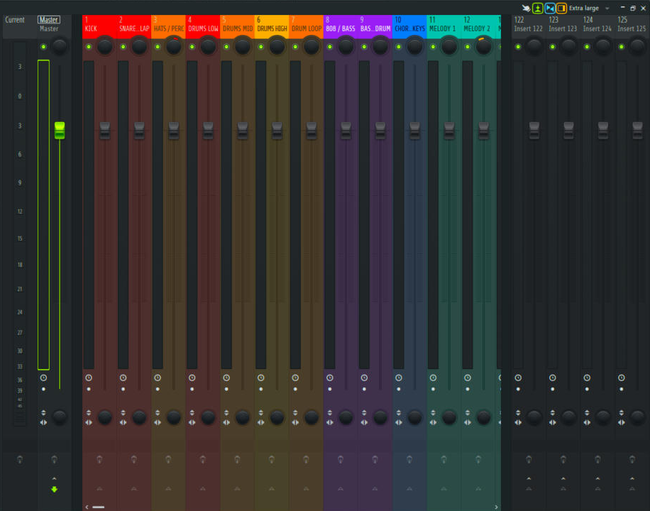
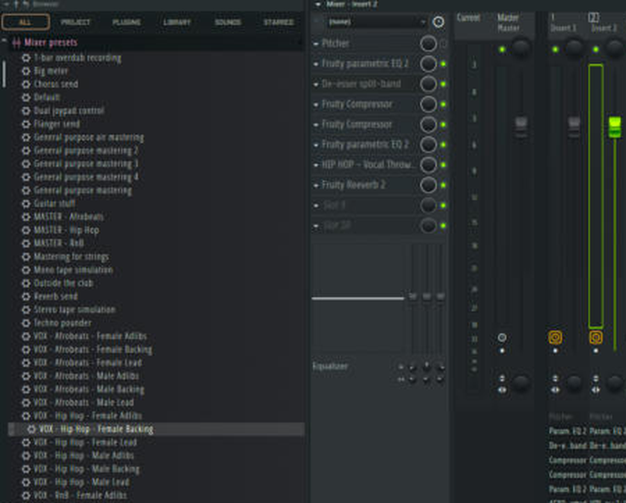
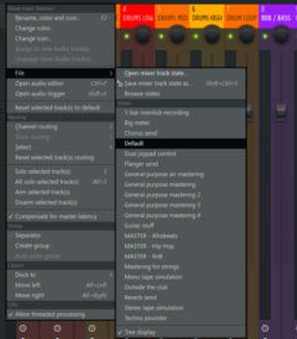
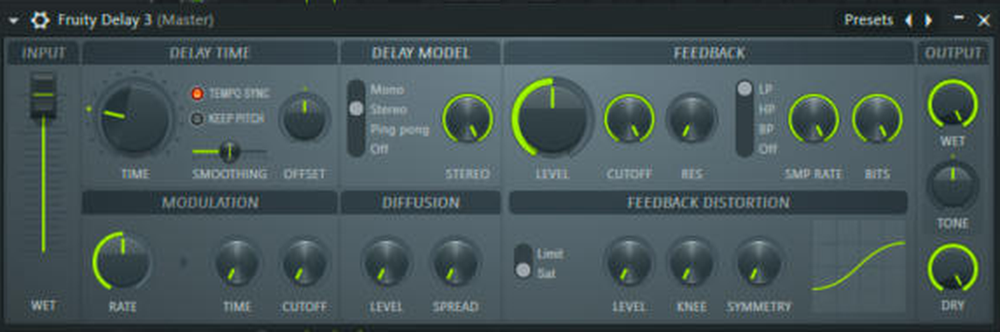
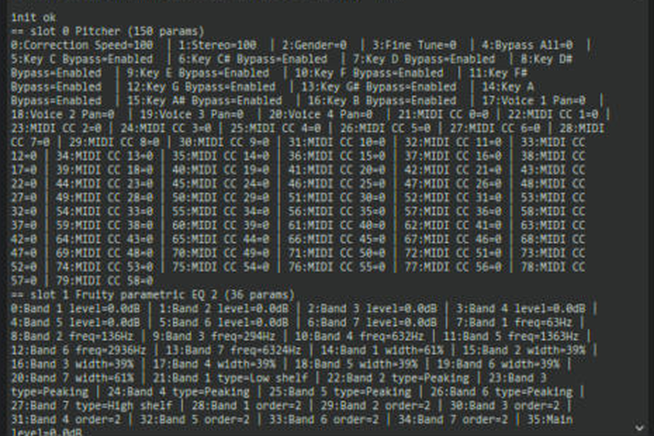

# Vibely Music Project

**An AI-assisted music production system for FL Studio. AI does the setup, routing and starting points; the human makes the music.**

Built by Louis with Claude (Anthropic) as an AI production assistant. Everything here was researched, built and tested inside a real FL Studio 21 session.

> 🎧 **Listen:** songs made with this system are collected in [`projects/`](projects/). First release coming soon.

---

## The idea

Making a track from a stem pack used to mean an hour of setup before any creative decisions: naming and coloring mixer tracks, routing stems, building vocal chains, guessing compressor settings, looking up delay times. None of that is creative, but all of it slows the creative part down.

This project hands that work to AI and leaves the taste, feel and final decisions with the human.

| AI handles | The human keeps |
|---|---|
| Researching best practice (EQ ranges, compression, loudness targets) | Choosing the sounds, the arrangement, the vibe |
| Building the mixer layout and routing stems automatically | Balancing by ear: what's loud, what's quiet |
| Creating starting-point presets for vocals, delays and mastering | Tweaking every preset to fit *this* song and *this* voice |
| Doing the maths (tempo-synced delays, frequency targets) | Deciding when a rule should be broken |
| Checking settings and catching mistakes | Saying "that's the one" |

Every preset is a **starting point, never a final answer**. See [docs/principles.md](docs/principles.md).

---

## What's built so far

| Tool | What it does | Docs |
|---|---|---|
| **Stem Mixer** (FL Studio script) | One step builds a color-coded 23-track mixer with drum, bass, music and vocal buses, then **routes every stem to the right track by its file name** | [stem-mixer.md](docs/stem-mixer.md) |
| **18 vocal presets** | Full 8-plugin vocal chains: Hip Hop / Afrobeats / R&B × Male / Female × Lead / Backing / Adlibs | [vocal-presets.md](docs/vocal-presets.md) |
| **3 master presets** | Stock-plugin mastering chains for Hip Hop, Afrobeats and R&B, with loudness targets | [master-presets.md](docs/master-presets.md) |
| **5 delay presets** | Tempo-synced Fruity Delay 3 echoes matched to each genre | [delay-presets.md](docs/delay-presets.md) |
| **Guides** | 4-page Quick Guide and a visual 4-page Mixing Cheat Sheet | [guides/](guides/) |

**Stock plugins only.** Everything uses plugins that ship with FL Studio 21. Pitcher (in the vocal presets, off by default) needs Signature edition or higher.

---

## Workflow: before vs after

| Step | Before | With Vibely |
|---|---|---|
| Set up mixer (names, colors, buses) | Manual, ~20-30 min | Automatic |
| Route each stem to a track | Manual, one by one | Automatic, by file name |
| Build a vocal chain | Load plugins and dial each one | One drag-and-drop preset |
| Delay timing | Calculate ms from BPM | Tempo-synced presets |
| Master chain | Load and set 4 plugins | One preset, then set the limiter gain |
| **Where your time goes** | Mostly setup | **Mostly listening and deciding** |

*Times are rough estimates for a typical stem-pack session.*

---

## Quick start

1. Install **loopMIDI** (free) on Windows and create one port. FL Studio only runs scripts through a MIDI device.
2. Copy [`fl-studio/scripts/StemMixer`](fl-studio/scripts/StemMixer) into your FL **User data folder** → `FL Studio\Settings\Hardware\`
   (check the exact path in *Options → File settings → User data folder*. It may be inside OneDrive).
3. Copy the `.fst` files:
   - `fl-studio/presets/mixer/*` → `FL Studio\Presets\Mixer presets\`
   - `fl-studio/presets/fruity-delay-3/*` → `FL Studio\Presets\Plugin presets\Effects\Fruity Delay 3\`
4. Restart FL Studio → **File → New** → drag your stems in.
5. **Options → MIDI Settings** → select the loopMIDI input → **Controller type: Stem Mixer**. The mixer builds itself.
6. Drag a **VOX** preset onto your vocal track and a **MASTER** preset onto the Master track. Then use your ears.

Full walkthrough: [docs/install.md](docs/install.md) · Printable: [Quick Guide](guides/Stem%20Mixer%20Quick%20Guide.pdf) · [Mixing Cheat Sheet](guides/Mixing%20Cheat%20Sheet.pdf)

---

## Screenshots

| | |
|---|---|
|  **The 23-track mixer, built and color-coded by the script** |  **Stems routed automatically by file name** |
|  **A VOX preset dragged onto a track: full chain in one go** |  **Master presets in FL's own menu** |
|  **Fruity Delay 3, tempo-synced** |  **The AI reading every plugin parameter to set exact values** |

More in [assets/screenshots/](assets/screenshots/).

---

## How it was built

The whole system was built in one conversation, with the AI researching, writing code and then **testing live inside FL Studio**. That testing caught real bugs that offline testing missed. The full story, including what went wrong and how it was fixed, is in [docs/how-it-was-built.md](docs/how-it-was-built.md).

---

## Repo layout

```
vibely-music-project/
├─ README.md                  ← you are here
├─ CHANGELOG.md               ← every change, newest first
├─ docs/                      ← one page per tool + principles + build story
├─ fl-studio/
│  ├─ scripts/StemMixer/      ← the FL Studio script
│  ├─ presets/mixer/          ← MASTER (3) + VOX (18) mixer track states
│  ├─ presets/fruity-delay-3/ ← 5 delay presets
│  └─ tools/                  ← developer tool used to build the vocal presets
├─ guides/                    ← PDFs + their HTML source
├─ projects/                  ← songs made with the system (links to listen)
└─ assets/screenshots/
```

## Roadmap

- [ ] First song produced with the system → SoundCloud link in `projects/`
- [ ] Reverb presets to match the delay presets
- [ ] Maximus versions of the master presets, for A/B comparison
- [ ] Instrument-bus presets (drums, 808, music)
- [ ] Notes from real sessions: what worked, what had to be tweaked

## License

[MIT](LICENSE). Use it, change it, share it. Credit appreciated.
