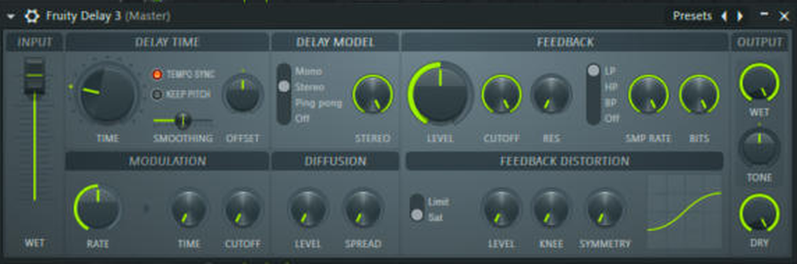
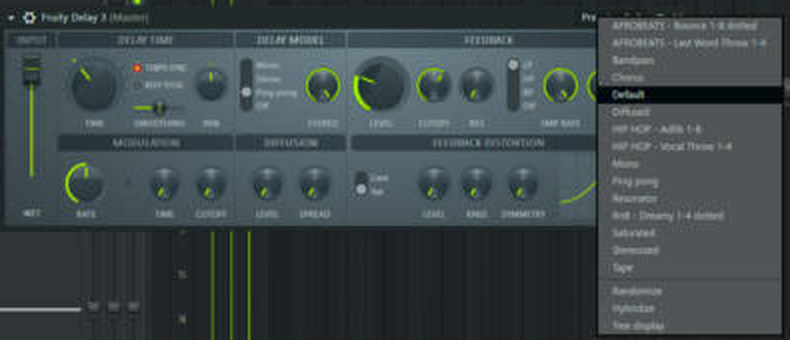

# Delay presets (7, Fruity Delay 3)

In `fl-studio/presets/fruity-delay-3/`. All are **tempo-synced**, so they follow the project BPM. Dry 0% (echo only): use them on a DELAY send track. (The VOX presets contain inline versions with dry 100%.)

| Preset | Time | Feedback | Repeats darkened at | Use |
|---|---|---|---|---|
| HIP HOP - Adlib 1-8 | 1/8 | 25% | ~6 kHz | adlibs, rap line ends |
| HIP HOP - Vocal Throw 1-4 | 1/4 | 20% | ~5 kHz | single-word throws |
| AFROBEATS - Last Word Throw 1-4 | 1/4 | 12% | ~6 kHz | last word of a phrase |
| AFROBEATS - Bounce 1-8 dotted | dotted 1/8, ping pong | 30% | ~7 kHz | groove on plucks/guitar/chants |
| RnB - Dreamy 1-4 dotted | dotted 1/4, ping pong | 35% | ~4 kHz | lush vocals, pads |
| HOUSE - Groove 1-8 dotted | dotted 1/8, ping pong | 36% | ~5 kHz | house leads/adlibs: swings against the 4/4 kick |
| HOUSE - Wash 1-4 | 1/4, ping pong | 45% | ~4 kHz | long, washed-out tails for backing vocals and breakdowns |

Manual maths: **one beat (1/4) in ms = 60,000 ÷ BPM**. At 86 BPM: 1/4 = 698 ms, 1/8 = 349, dotted 1/8 = 523, dotted 1/4 = 1047. At 124 BPM (house): 1/4 = 484 ms, dotted 1/8 = 363.

