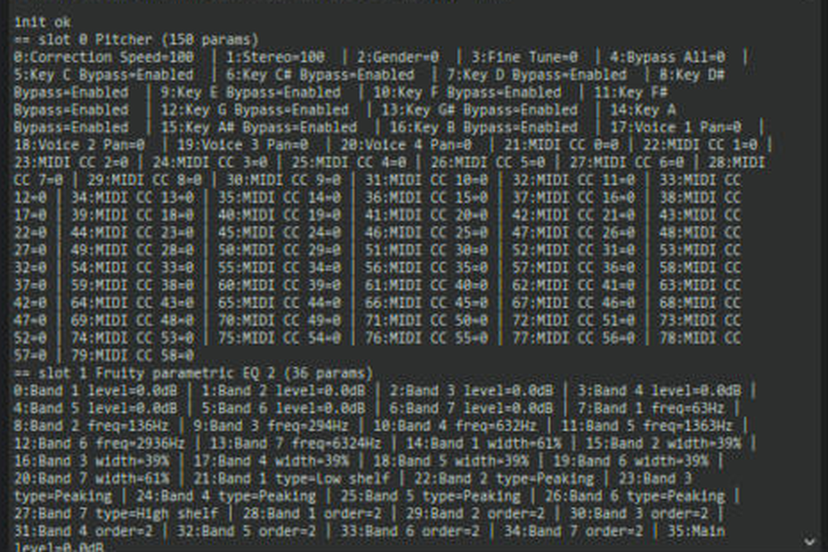

# How it was built

Built by Louis (producer, director) with Claude (AI assistant) in one long session on 6-7 Nov 2026, in FL Studio 21.2.3 (All Plugins Edition) on Windows.

## How the AI worked
| Capability | Used for |
|---|---|
| **Web research** | Mixing practice: EQ ranges, compression, de-essing, loudness, sidechain, genre vocal styles |
| **Writing code** | The Stem Mixer script and the vocal preset builder (Python for FL Studio's scripting API) |
| **File access on the PC** | Installing scripts and presets in the right folders, verifying saved files |
| **Screen control** | Driving FL Studio: loading plugins, reading values, saving presets. The human approved every app it could touch |

## Timeline
1. **v1-v2: stem templates.** First scripts were offline-tested only. A downloadable ZIP and PDF guide were added after the first delivery couldn't be downloaded.
2. **"It's not showing up."** The script was never listed in FL. Root cause, found by looking at FL's own settings: the user data folder was in **OneDrive\Documents**, not Documents. Every copy had gone to the wrong place.
3. **v3: simpler + auto-routing.** Cut from 47 to 23 tracks and added stem routing by file name. A live test in FL found two bugs offline tests missed:
   - a channel API call that isn't supported in FL 21 (0 stems routed) → fixed;
   - sends created at full volume because send levels can't be set by script → sends removed.
4. **Master presets.** Built on screen using FL's own plugin presets (*20Hz + 18kHz cut*, *Master 1*, *Light*) and saved as mixer track states.
5. **Delay presets.** FL's knob "type in value" uses a hidden 0-1 scale, which was calibrated per knob (e.g. feedback % = value × 125; time 4:0 = 0.249).
6. **18 vocal presets.** The AI loaded the 8-plugin chain once, then used FL's scripting API to set every parameter **by its displayed value** (Hz, dB, ms) with a bisection search, and printed a read-back to verify. Fruity Delay 3 can't be written by script, so its presets were loaded through the GUI. A final test dragged a saved preset onto a fresh track and read all values back.
7. **Mixing Cheat Sheet.** A visual 4-page reference: signal flow, level ladder, frequency map, preset picker, sidechain map, stereo stage, fix-it table.

## Lessons
- **Test inside the real tool.** Mock tests passed. FL itself found 3 real bugs.
- **Check the user's actual setup** (OneDrive folders, edition, API version) before assuming paths or features.
- **Be honest about limits.** FL presets can't be created outside FL; scripts can't load plugins or sidechains. The system works around these instead of hiding them.
- **Verify by reading back.** Every value set by the AI was read back from FL before saving.

## Screenshots from the session

