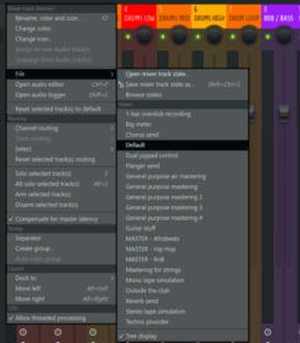
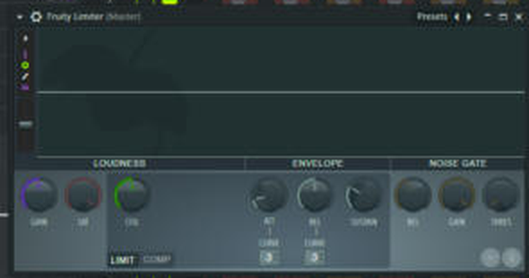

# Master presets (4)

Mixer track states in `fl-studio/presets/mixer/`. Load with: right-click the Master track → **File** → pick one, or drag from Browser → Mixer presets.

| Slot | Plugin | MASTER - Hip Hop | MASTER - RnB | MASTER - Afrobeats | MASTER - House |
|---|---|---|---|---|---|
| 1 | Fruity Parametric EQ 2 | FL preset *20Hz + 18kHz cut* | same | same | same |
| 2 | Fruity Compressor | FL preset *Master 1* (3.2:1, 11 ms) | FL preset *Light* (1.7:1, 49 ms) | *Light* | **Groove glue:** 2.2:1, 33 ms attack, 167 ms release, -8.4 dB thr |
| 3 | Fruity Soft Clipper | On | **Off** | On | On |
| 4 | Fruity Limiter | CEIL -1.0 dB | same | same | same |
| | **Loudness target** | -9 to -7 LUFS | -11 to -9 LUFS | -9 to -8 LUFS | -9 to -8 LUFS |

**Your job:** raise the Limiter GAIN per song until you hit the target. Measure with the free Youlean Loudness Meter. Keep true peak ≤ -1 dB.

**Why House is different:** a slower attack (33 ms) lets the kick's punch through before the compressor grabs, and a fast-ish release (167 ms) recovers between kicks at 120-128 BPM, so the mix "breathes" with the four-on-the-floor.

Sources: Venia Mastering and Mastering France (hip-hop loudness), Image-Line forum (clip before limit).

