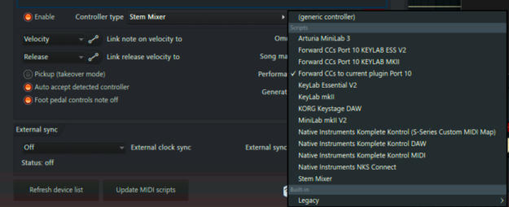
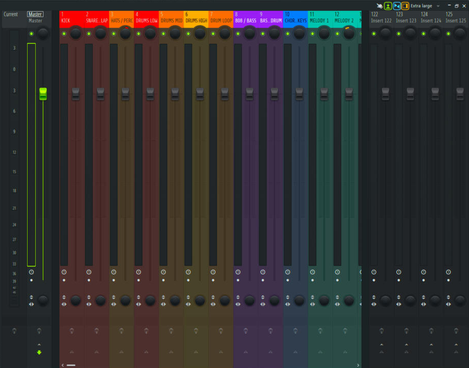
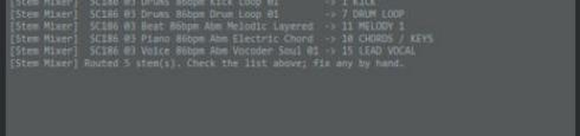

# Stem Mixer script

`fl-studio/scripts/StemMixer/device_StemMixer.py`, an FL Studio MIDI-controller script (Python, FL 21, scripting API v30).

## What it does
When you select **Stem Mixer** as the controller type:
1. **Builds** a 23-track, color-coded mixer, but only in an empty project. It never touches a mixer you've already named.
2. **Routes** every stem in the Channel Rack to the right track by reading its file name.

| Tracks | Name | Goes to |
|---|---|---|
| 1-7 | KICK · SNARE/CLAP · HATS/PERC · DRUMS LOW · MID · HIGH · DRUM LOOP | DRUMS BUS (18) |
| 8-9 | 808/BASS · BASS 2/LOG DRUM | BASS BUS (19) |
| 10-14 | CHORDS/KEYS · MELODY 1-3 · FX/RISERS | MUSIC BUS (20) |
| 15-16 | LEAD VOCAL · BACKING/ADLIBS | VOCAL BUS (21) |
| 17 | FULL MIX (REF), muted | Master |
| 22-23 | REVERB · DELAY | Master |

## Name matching (examples)
`kick` → KICK · `clap / snare / rim` → SNARE · `drums low` → DRUMS LOW · `log drum` → BASS 2 · `808 / bass / sub` → 808 · `hat / shaker / perc / conga` → HATS/PERC · `chord / keys / piano / pad` → CHORDS · `vocal / vox / hook` → LEAD VOCAL · `adlib / backing / harmony` → BACKING · `full mix / instrumental` → REF · anything else melodic → MELODY 1-3 (spread out).

Stems you've put on track 24 or higher are never moved. Run it again any time by switching Controller type away and back.

## Known limits (FL Studio 21)
- Scripts can't load plugins or create sidechain links, so those are manual (see the guides).
- Send levels can't be set by script in API v30, so no reverb/delay sends are pre-made (they'd play at full volume).
- Matching uses plain text only, with no extra Python modules, for FL's embedded Python.
