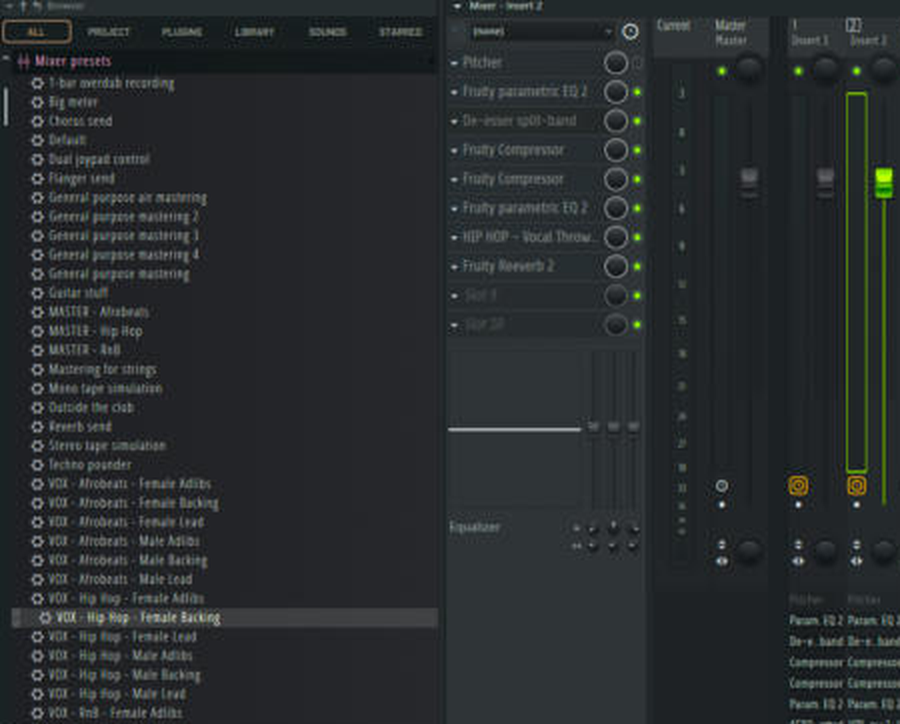

# Vocal presets (24)

Mixer track states named `VOX - <Genre> - <Voice> <Role>` in `fl-studio/presets/mixer/`.
**Load:** Browser → Mixer presets → drag onto your vocal track. The track keeps its name.

|  | Lead | Backing | Adlibs |
|---|---|---|---|
| **Hip Hop** (rap) | M / F | M / F | M / F |
| **Afrobeats** (sung, bright) | M / F | M / F | M / F |
| **RnB** (sung, smooth) | M / F | M / F | M / F |
| **House** (sung, big space) | M / F | M / F | M / F |

## The chain (same in all 24)
`1 Pitcher (OFF)` → `2 Parametric EQ 2 (clean)` → `3 Maximus "De-esser split band"` → `4 Fruity Compressor (fast)` → `5 Fruity Compressor (smooth, Soft)` → `6 Parametric EQ 2 (tone)` → `7 Fruity Delay 3 (inline, dry 100%)` → `8 Fruity Reeverb 2 (dry 100%)`

Order from research: clean EQ → de-ess → 2-stage compression → tone EQ → time effects.

## Voice (male / female)
| | Male | Female |
|---|---|---|
| Low-cut (lead) | 90 Hz | 120 Hz |
| Mud cut | 300 Hz | 450 Hz |
| Nasal band | 1 kHz | 1.2 kHz |
| Presence | 3.5 kHz | 5 kHz |
| De-ess split | 5 kHz | 7 kHz |
| Air shelf | 10 kHz | 12 kHz |

## Role
| | Lead | Backing | Adlibs |
|---|---|---|---|
| Low-cut | voice value | +80 Hz | +160 Hz |
| Mud cut | -2.5 dB | -4 dB | -3 dB |
| Presence | +2 dB | **-2 dB** | +2.5 dB |
| Top | air +2.5 to +3.5 dB | low-pass 11 kHz | air +1.5 dB |
| Fast comp ratio | genre | 4:1 | 4:1 |
| Delay wet | 15% | 18% | 25% |
| Fader | 0 dB (set backing -6 to -9 dB, adlibs -4 to -6 dB yourself) | | |

## Genre
| | Hip Hop | Afrobeats | RnB | House |
|---|---|---|---|---|
| Fast comp | -18 dB, 4:1, 1.5 ms / 110 ms | -20 dB, 3:1, 5 ms / 100 ms | -20 dB, 3:1, 15 ms / 120 ms | -20 dB, 4:1, 3 ms / 80 ms |
| Smooth comp | 2.5:1, 25 ms / 220 ms | 2:1, 30 ms / 200 ms | 2:1, 30 ms / 250 ms | 2:1, 30 ms / 200 ms |
| Lead nasal cut | -1.5 dB | 0 | 0 | 0 |
| Lead air | +2.5 dB | +3.5 dB | +3 dB | +3.5 dB |
| Reverb (lead) | size 30, 0.9 s, 25 ms pre, 12% | 40, 1.2 s, 30 ms, 15% | 60, 2.2 s, 40 ms, 18% | 65, 1.8 s, 35 ms, 15% |
| Delay | Vocal Throw 1/4 · adlibs 1/8 | Last Word 1/4 · backing/adlibs dotted 1/8 | dotted 1/8 · backing dotted 1/4 | Groove dotted 1/8 · backing Wash 1/4 (wet 20%) |

Reverb: low cut 350 Hz, high cut 7 kHz (lead) / 6 kHz (others), dry 100%.

All genre numbers live in [`fl-studio/tools/genres.py`](../fl-studio/tools/genres.py). New genre? See [add-a-genre.md](add-a-genre.md).

## Tweak per song
1. **Compressor THRESHOLD** (slots 4-5): aim for 3-6 dB of reduction on slot 4 and 1-3 dB on slot 5 on the loudest line.
2. **De-esser** amount to taste.
3. **Pitcher** ON + set key for sung vocals.

## Sources
Ghostnote (rap vocal chain; de-essing in FL Studio) · Dan Murtagh (vocal EQ cheat sheet) · Rys Up Audio (R&B vocals) · Antares (Afrobeats vocal production) · Audient (basic vocal chain) · Adrian Milea & Modern Mixing (background vocals) · Avid (vocal EQ).
